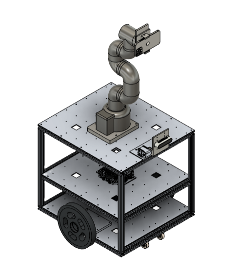
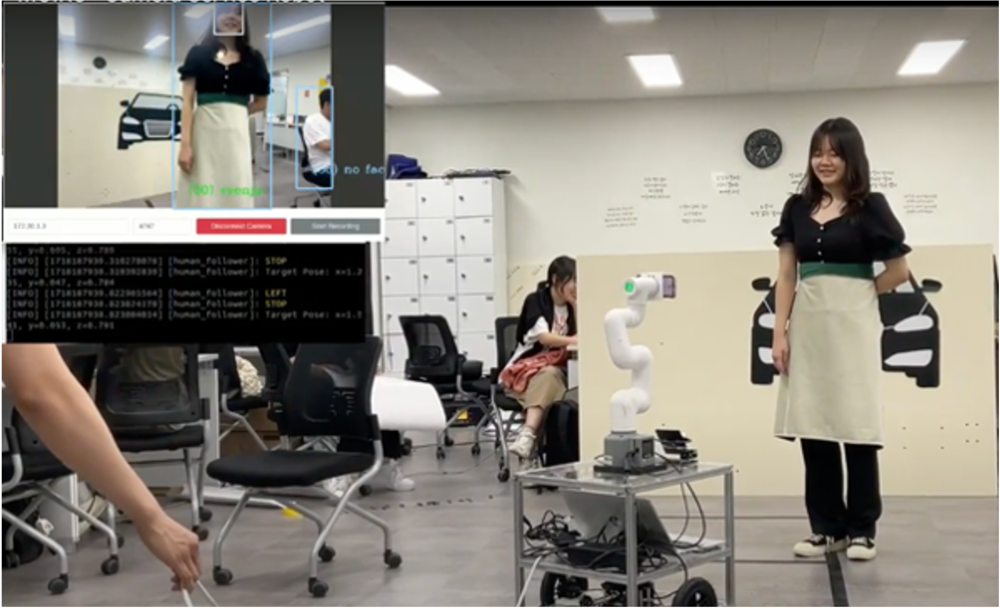
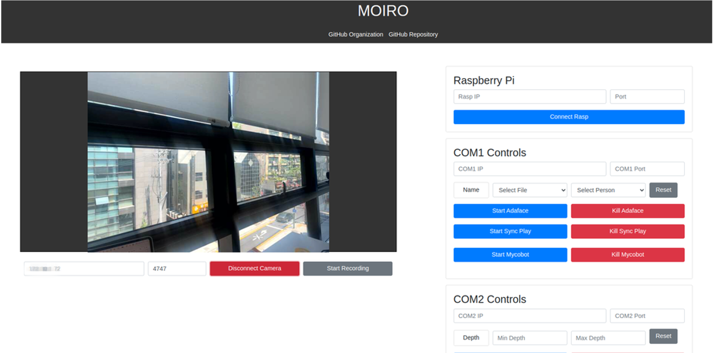
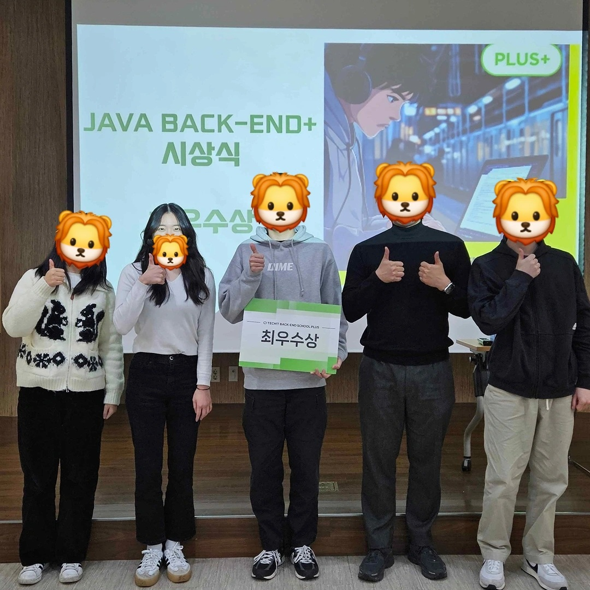
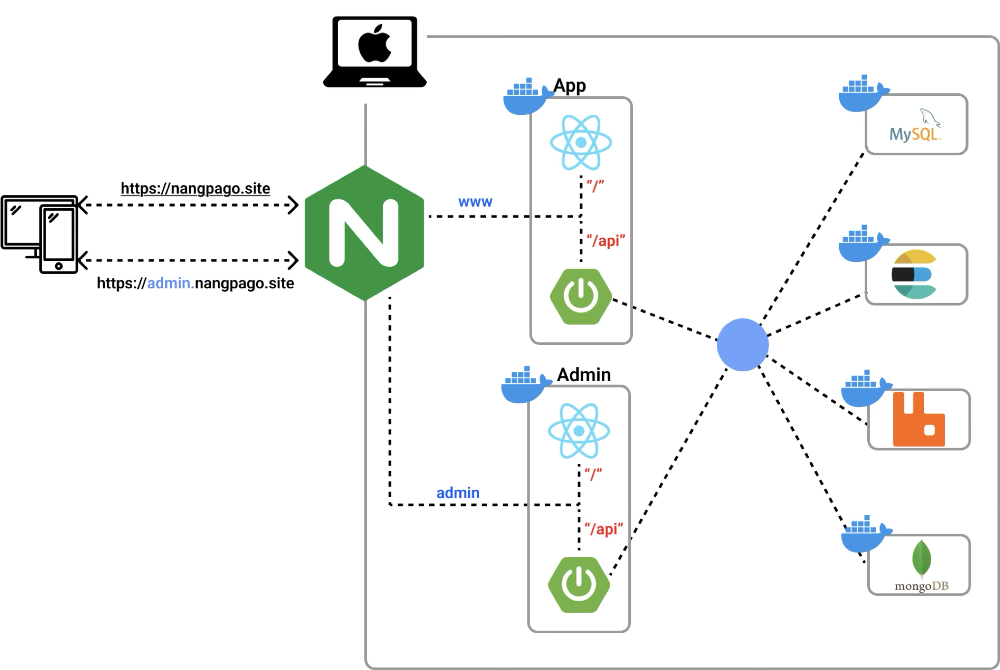
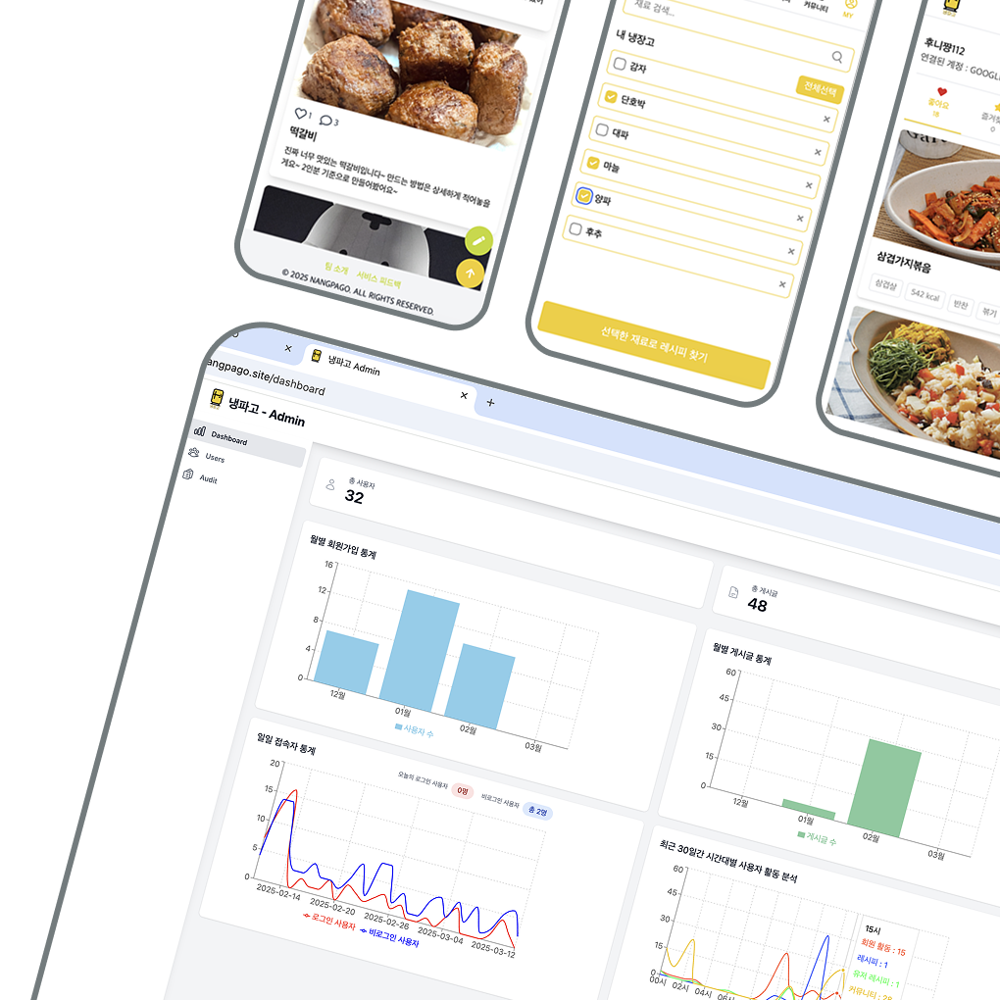
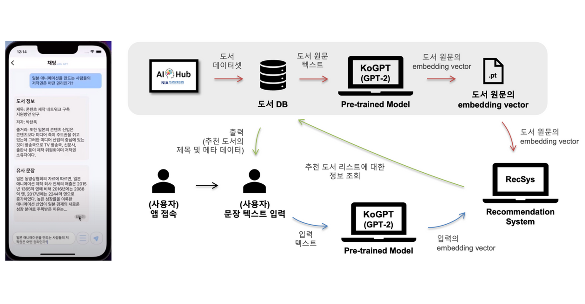
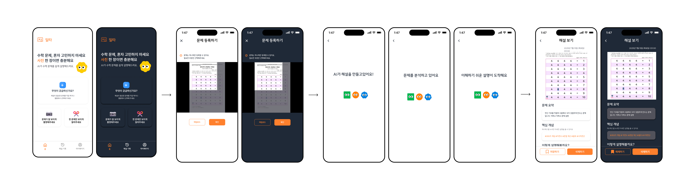
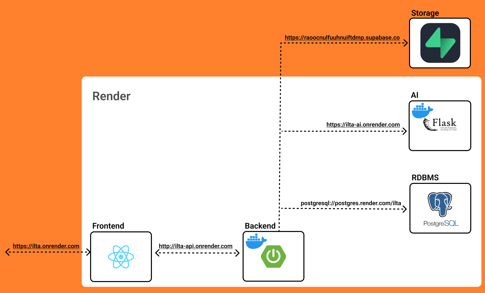
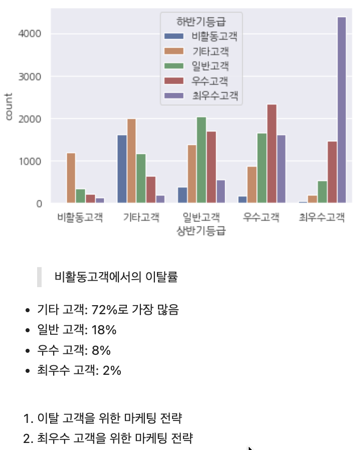

# YeonJu Lee

**스마트팩토리와 로봇 데이터 엔지니어링**

로봇, 센서, 서비스에서 나온 데이터를 수집하고, 이후 단계에서 쓸 수 있도록 정제해 적재합니다.  
Java와 Python으로 장비와 시스템 사이의 인터페이스와 백엔드를 만들고, SQL과 메시지 브로커로 그 흐름을 운영합니다.

## Tech Stack

## Projects

### [MOIRO: Vision AI 자율 촬영 로봇](https://github.com/MOIRO-KAIROS/moiro_ws) (로봇 장비 데이터 수집)

AGV, 로봇 암, 카메라를 ROS2와 HTTP API로 묶어, 영상과 제어를 한 경로로 모으는 시스템입니다.

- 웹(Flask)에서 라즈베리파이, COM1, COM2로 HTTP 요청을 보내고, 각 장비는 ROS2로 AGV, 로봇 암(MyCobot), RealSense, AdaFace, YOLOv8를 실행
- 촬영 화면은 DroidCam 프레임을 읽어 mp4로 기록하고, fps는 장치 값(`CAP_PROP_FPS`)을 그대로 사용
- Flask, ROS2, YOLOv8, AdaFace

  

---

### [NangPaGo: 재료 기반 레시피 추천 웹 서비스](https://github.com/MARS-LIKELION/NangPaGo) (검색 데이터 파이프라인, 이벤트 처리)

재료와 커뮤니티 이벤트를 검색 인덱스와 메시지 큐에 올리고, 운영 현황은 대시보드에서 봅니다.  
멋쟁이사자처럼 Java Back-end+ **최우수상**.

- MySQL의 레시피 데이터를 Elasticsearch에 동기화하고 검색
- RabbitMQ로 좋아요, 알림 이벤트를 비동기 처리하고 SSE로 전달
- Docker, Jenkins로 배포하고, Admin에서 이용 통계와 감사 로그를 모니터링
- Spring Boot, MySQL, Elasticsearch, RabbitMQ

[서비스](https://nangpago.site/)

  
멋쟁이사자처럼 Java Back-end+ 최우수상

 

---

### [Cometext: 문장 맥락 기반 도서 추천 시스템](https://github.com/Hanium-Cometext/cometext-gpt) (도서 원문 임베딩 파이프라인)

AI Hub 도서 요약 JSON 2,000건을 적재하고, 원문 임베딩을 만든 뒤, 유사 도서를 조회합니다.

- 적재: JSON을 SQLite `books.db`에 저장 (제목, 원문, 저자, 요약)
- 임베딩 생성: KoGPT2(`skt/kogpt2-base-v2`)로 원문을 벡터화해 PyTorch 텐서 `embeddings.pt`에 저장
- 조회: 질의 문장을 같은 모델로 임베딩하고, PyTorch 코사인 유사도로 상위 k건을 고른 뒤 SQLite에서 제목과 메타데이터를 읽음

---

### [ILTA: 우리 아이 수학 설명 도우미](https://github.com/ocy-likelion/AI_teacher_2_backend/) (이미지 입력 전처리)

문제 사진을 텍스트로 정제한 뒤 해설을 만들어 저장하는 인턴 프로젝트입니다.

- 문제 이미지를 AI 서버로 보내고, 받은 OCR 결과와 해설을 PostgreSQL에 저장
- Render에 API를 배포 (`ilta-api.onrender.com`)
- Spring Boot, Flask, PostgreSQL

---

### [CRM 고객 세그먼트 예측 모델](https://github.com/yeonju52/Market_RecSys.git) (고객 행동 데이터 전처리)

구매, 이용 로그를 고객군으로 나누고, LightGBM으로 세그먼트를 예측했습니다. 기타고객/비활동고객 F1 0.73.

Pandas, LightGBM

---

## 그 외

- [AIFT](https://github.com/Filter-Web/AI): Flask에서 웹캠 프레임을 받아 얼굴을 검출. Spring Boot 연결은 그 저장소 README에 이후 단계로 적혀 있음

## 학습

- [Velog 알고리즘 기록](https://velog.io/@yeonju52/series/%EC%BD%94%ED%85%8CC)
- [학부연구, Computer Vision](https://github.com/yeonju52/ComputerVision)

---

© 2026 YeonJu Lee
